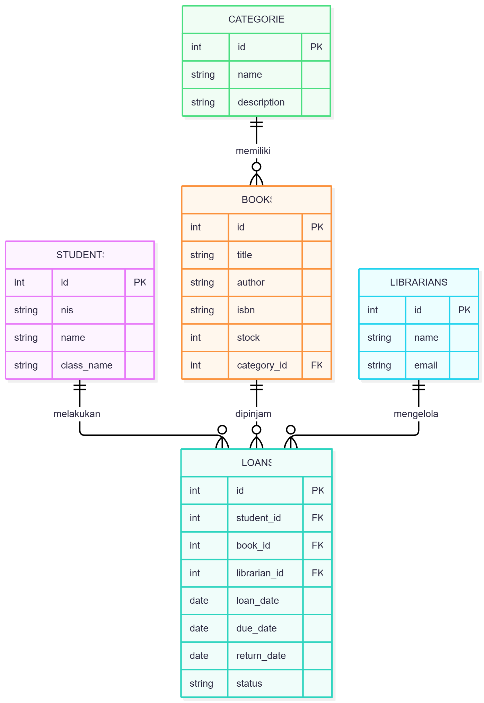

# Sistem Perpustakaan Sekolah — REST API

## 1. Deskripsi Proyek

Sistem Perpustakaan Sekolah adalah REST API untuk mengelola data buku dan kategori buku serta menyediakan struktur database untuk data siswa, petugas perpustakaan, dan transaksi peminjaman. API dibangun menggunakan Node.js, Express.js, dan PostgreSQL.

Proyek ini dibuat sebagai tugas akhir Learning Labs Backend Development untuk menerapkan konsep REST API, CRUD, database relasional, deployment, dan pengujian API.

## 2. Teknologi yang Digunakan

- Node.js
- Express.js
- PostgreSQL
- Neon sebagai layanan database PostgreSQL
- Vercel untuk deployment API
- Postman untuk pengujian endpoint
- Git dan GitHub untuk pengelolaan kode

## 3. Database dan Relasi

Database terdiri dari lima tabel:

1. `students` — menyimpan data siswa.
2. `librarians` — menyimpan data petugas perpustakaan.
3. `categories` — menyimpan kategori buku.
4. `books` — menyimpan data buku.
5. `loans` — menyimpan transaksi peminjaman dan pengembalian buku.

### Relasi antartabel

- `categories.id` → `books.category_id`
- `students.id` → `loans.student_id`
- `books.id` → `loans.book_id`
- `librarians.id` → `loans.librarian_id`

### Diagram ERD



## 4. URL Deployment

- **Base URL:** [https://perpustakaan-backend-omega.vercel.app/](https://perpustakaan-backend-omega.vercel.app/)
- **Health check:** [https://perpustakaan-backend-omega.vercel.app/health](https://perpustakaan-backend-omega.vercel.app/health)
- **Daftar kategori:** [https://perpustakaan-backend-omega.vercel.app/categories](https://perpustakaan-backend-omega.vercel.app/categories)
- **Daftar buku:** [https://perpustakaan-backend-omega.vercel.app/books](https://perpustakaan-backend-omega.vercel.app/books)

## 5. Daftar Endpoint

| Method | Endpoint      | Deskripsi                            |
| ------ | ------------- | ------------------------------------ |
| GET    | `/health`     | Memeriksa status API                 |
| GET    | `/categories` | Mengambil semua kategori             |
| POST   | `/categories` | Menambahkan kategori baru            |
| GET    | `/books`      | Mengambil semua buku                 |
| GET    | `/books/:id`  | Mengambil detail buku berdasarkan ID |
| POST   | `/books`      | Menambahkan buku baru                |
| PUT    | `/books/:id`  | Memperbarui data buku                |
| DELETE | `/books/:id`  | Menghapus buku berdasarkan ID        |

**Catatan:** Database sudah memiliki tabel siswa, petugas, dan peminjaman. Endpoint API untuk ketiga tabel tersebut belum termasuk dalam daftar endpoint di atas.

## 6. Contoh Request API

Semua request yang mengirimkan data JSON menggunakan header:

`Content-Type: application/json`

### A. Menambahkan kategori

**Method:** `POST`

**URL:** `/categories`

Request body:

```json
{
  "name": "Sains",
  "description": "Buku ilmu pengetahuan"
}
```

Contoh respons sukses:

```json
{
  "data": {
    "id": 2,
    "name": "Sains",
    "description": "Buku ilmu pengetahuan"
  }
}
```

Struktur respons sebenarnya mengikuti respons yang dikirimkan oleh aplikasi.

### B. Menambahkan buku

**Method:** `POST`

**URL:** `/books`

Request body:

```json
{
  "title": "Laskar Pelangi",
  "author": "Andrea Hirata",
  "isbn": "9789793062792",
  "stock": 10,
  "category_id": 1
}
```

Data buku memuat judul, penulis, ISBN, jumlah stok, dan ID kategori.

### C. Mengambil semua buku

**Method:** `GET`

**URL:** `/books`

Endpoint ini mengambil daftar buku yang tersimpan di database, termasuk nama kategorinya.

### D. Mengambil detail buku

**Method:** `GET`

**URL:** `/books/1`

Ganti `1` dengan ID buku yang ingin dilihat.

### E. Memperbarui buku

**Method:** `PUT`

**URL:** `/books/1`

Request body:

```json
{
  "title": "Laskar Pelangi",
  "author": "Andrea Hirata",
  "isbn": "9789793062792",
  "stock": 15,
  "category_id": 1
}
```

Ganti ID dan data sesuai buku yang ingin diperbarui.

### F. Menghapus buku

**Method:** `DELETE`

**URL:** `/books/1`

Ganti `1` dengan ID buku yang akan dihapus. Penghapusan dapat ditolak jika buku masih digunakan dalam transaksi peminjaman.

## 7. Format Respons dan Penanganan Error

Respons sukses menggunakan JSON. Status HTTP yang digunakan bergantung pada endpoint, misalnya:

- `200 OK` — request berhasil.
- `201 Created` — data baru berhasil dibuat.
- `400 Bad Request` — data atau parameter request tidak valid.
- `404 Not Found` — data tidak ditemukan.
- `409 Conflict` — terjadi konflik data, misalnya ISBN duplikat atau buku masih direferensikan transaksi.
- `500 Internal Server Error` — terjadi kesalahan pada server.

Contoh format error berikut hanya ilustrasi; sesuaikan dengan respons aktual dari aplikasi:

```json
{
  "message": "Data tidak ditemukan"
}
```

## 8. Cara Menjalankan Proyek Secara Lokal

1. Pastikan Node.js sudah terpasang.

2. Clone repository:

   ```bash
   git clone https://github.com/sofiadila1601-lang/perpustakaan_backend.git
   ```

3. Masuk ke folder proyek:

   ```bash
   cd perpustakaan_backend
   ```

4. Instal dependency:

   ```bash
   npm install
   ```

5. Buat file `.env` di folder utama proyek:

   ```env
   DATABASE_URL=isi_connection_string_postgresql
   PORT=3000
   ```

   Ganti nilai `DATABASE_URL` dengan connection string database PostgreSQL milik sendiri.

6. Jalankan server pengembangan:

   ```bash
   npm.cmd run dev
   ```

   Perintah tersebut digunakan pada PowerShell Windows jika script `dev` sudah tersedia di `package.json`.

7. Buka endpoint berikut di browser atau Postman:

   `http://localhost:3000/health`

**Penting:** Jangan mengunggah file `.env` ke GitHub karena berisi informasi koneksi database. Pastikan file tersebut tercantum dalam `.gitignore`.

## 9. Pengujian API

Pengujian dilakukan menggunakan Postman terhadap API yang sudah di-deploy ke Vercel.

Endpoint yang perlu diuji:

- [x] `GET /health`
- [x] `GET /categories`
- [x] `POST /categories`
- [x] `GET /books`
- [x] `GET /books/:id`
- [x] `POST /books`
- [x] `PUT /books/:id`
- [x] `DELETE /books/:id`

Bukti pengujian disertakan dalam bentuk screenshot yang menampilkan method, URL, status HTTP, dan respons JSON, atau melalui export collection Postman.

## 10. Repository

**GitHub:** [https://github.com/sofiadila1601-lang/perpustakaan_backend](https://github.com/sofiadila1601-lang/perpustakaan_backend)

**Deployment:** [https://perpustakaan-backend-omega.vercel.app/](https://perpustakaan-backend-omega.vercel.app/)
